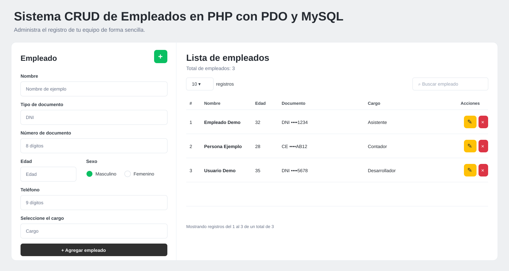
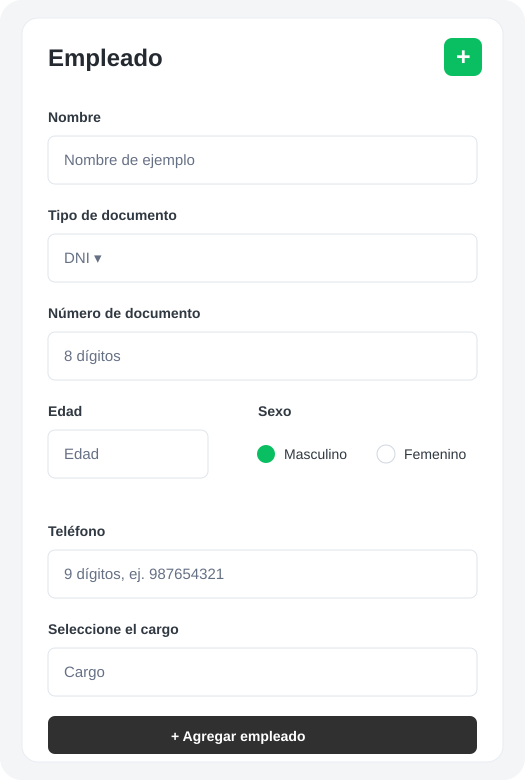

# CRUD de empleados con PHP, PDO y MySQL

Aplicación web para registrar y administrar empleados. Proyecto local preparado para ejecutarse con Apache y MySQL de XAMPP.

## Capturas

Las vistas siguientes son ilustrativas y usan datos ficticios; no exponen los datos reales de la base local.

### Vista de escritorio



### Formulario adaptable



## Funcionalidades

- Crear, listar, buscar, editar y eliminar empleados.
- Paginación de resultados y numeración correlativa en la tabla.
- Tipo de documento peruano: DNI o carné de extranjería (CE).
- Validación de DNI de 8 dígitos, teléfono peruano de 9 dígitos y campos requeridos.
- Consultas MySQL preparadas con PDO y protección CSRF en las operaciones de escritura.
- Interfaz adaptable a escritorio y móvil.

## Tecnologías

- PHP 8.1 o superior (PDO, `pdo_mysql` y `mbstring`).
- MySQL/MariaDB incluido con XAMPP.
- HTML, CSS, JavaScript y Bootstrap 5.

## Estructura del proyecto

```text
crud/
├── app/
│   └── empleados.php       # Validación y operaciones CRUD
├── config/
│   └── db.php              # Conexión PDO a crud_empleados
├── db/
│   └── database.sql        # Único SQL: esquema nuevo y migración antigua
├── docs/
│   └── images/             # Ilustraciones incluidas en este README
├── api.php                 # Entrada HTTP de la API
├── index.html              # Interfaz
├── js.js                   # Interacciones con la API
├── styles.css              # Estilos
└── README.md
```

## Instalación y ejecución local

1. Copia el proyecto dentro de `C:\xampp\htdocs\crud`.
2. Abre el panel de XAMPP e inicia **Apache** y **MySQL**.
3. Entra a [phpMyAdmin](http://localhost/phpmyadmin), selecciona la pestaña **Importar** y carga `db/database.sql`. El script crea o actualiza la tabla sin eliminar los empleados existentes.
4. Si tu usuario/clave de MySQL no son los valores por defecto de XAMPP, ajusta `DB_USER` y `DB_PASS` en `config/db.php`.
5. Abre [http://localhost/crud/](http://localhost/crud/).

La aplicación utiliza una sola base MySQL: **`crud_empleados`**. `db/database.sql` es el archivo de esquema/migración; no es otra base de datos. El script conserva los registros antiguos, cambia `cedula` a `numero_documento` cuando corresponde y agrega el tipo de documento.

## Operaciones CRUD

| Operación | Método HTTP | Uso |
|---|---|---|
| Leer | `GET` | Lista, búsqueda y paginación de empleados. |
| Crear | `POST` | Registra un empleado. |
| Actualizar | `PUT` | Guarda cambios de un empleado. |
| Eliminar | `DELETE` | Elimina el empleado indicado. |

El navegador envía las escrituras como JSON mediante `fetch`; por eso el backend lee el cuerpo JSON y no directamente `$_POST`. Las consultas a MySQL están parametrizadas con PDO.

## Publicar en GitHub con una cuenta distinta a la de VS Code

La cuenta mostrada en VS Code no determina necesariamente qué credencial usará `git push`. La identidad del commit (`git config user.name` y `user.email`) tampoco autentica el acceso: la autenticación la realiza GitHub CLI o Git Credential Manager.

### Opción recomendada: GitHub CLI

1. Crea en la cuenta destino un repositorio vacío llamado, por ejemplo, `crud-empleados-php`. No lo inicialices con otro README.
2. En la terminal de VS Code, entra a la carpeta del proyecto y autentica GitHub CLI con la cuenta destino:

   ```powershell
   gh auth status
   gh auth login --hostname github.com --git-protocol https --web
   ```

   Completa el inicio de sesión en el navegador con la cuenta donde creaste el repositorio. Si ambas cuentas ya están autorizadas en GitHub CLI, cambia la cuenta activa con:

   ```powershell
   gh auth switch --hostname github.com --user TU_USUARIO_DESTINO
   gh auth setup-git
   ```

3. Inicializa el repositorio local, configura el nombre/email que quieres mostrar como autor, vincula el repositorio remoto y publica:

   ```powershell
   git init -b main
   git config user.name "Tu nombre"
   git config user.email "correo-de-la-cuenta-destino@example.com"
   git add .
   git commit -m "feat: CRUD de empleados con PHP y PDO"
   git remote add origin https://github.com/TU_USUARIO_DESTINO/crud-empleados-php.git
   git push -u origin main
   ```

   Sustituye `TU_USUARIO_DESTINO` y el correo por los de tu cuenta/repositorio. Si ya existe un remoto `origin`, usa `git remote set-url origin URL_DEL_REPOSITORIO` en vez de `git remote add`.

### Si no usas GitHub CLI

Inicia sesión en [GitHub](https://github.com) con la cuenta destino y crea el repositorio vacío. En el primer `git push`, Git Credential Manager puede pedir autenticación; elige esa cuenta. Si Windows reutiliza la cuenta equivocada, elimina la credencial guardada de `github.com` desde **Administrador de credenciales de Windows** y vuelve a ejecutar `git push`.

Antes de publicar, comprueba `git status` y confirma que no hayas agregado copias de bases de datos, contraseñas reales ni datos personales de empleados. La carpeta `docs/images` usa datos ficticios.

Documentación oficial: [agregar código local a GitHub](https://docs.github.com/en/migrations/importing-source-code/using-the-command-line-to-import-source-code/adding-locally-hosted-code-to-github), [autenticación de GitHub CLI](https://docs.github.com/en/github-cli/github-cli/authenticating-with-github-cli) y [cambiar cuenta activa de GitHub CLI](https://cli.github.com/manual/gh_auth_switch).
